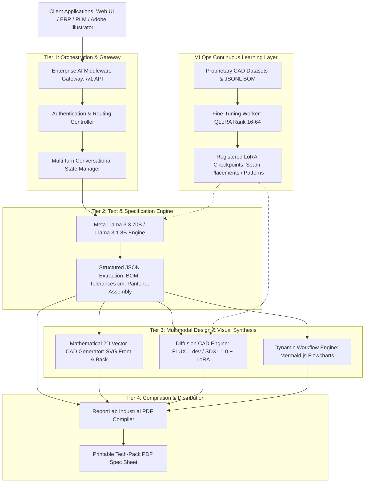

# Cloudy365 Enterprise AI TechPack Platform
## Executive Architecture & System Specification Document
**Prepared for:** Enterprise Client Presentation & Technical Evaluation  
**Platform Version:** 2.0.0 (Enterprise Gateway Edition)  
**Classification:** Confidential / Technical Whitepaper  
**Date:** October 2026  

---

## 1. Executive Summary: What Is It?

**Cloudy365 AI** is an enterprise-grade Autonomous Fashion-Tech & Industrial Specification Engine designed for apparel brands, industrial textile manufacturers, and design studios. 

Traditionally, translating a creative design concept into a factory-ready **Technical Specification Pack (Tech-Pack)** requires days to weeks of manual labor:
1. Fashion designers produce mood boards and artistic sketches.
2. Technical designers manually redraw vector CAD flats (front and back views) in Adobe Illustrator.
3. Production engineers calculate metric measurements, tolerance grades, and stitch per inch (SPI).
4. Sourcing managers manually compile the Bill of Materials (BOM), fabric treatments, and Pantone color codes.
5. Manufacturing managers document the step-by-step assembly and quality control (QC) sequence.

**Cloudy365 AI automates this entire lifecycle in seconds.**

A user inputs a natural language design concept into a conversational interface (ChatGPT/Gemini style). The platform autonomously outputs:
- **Comprehensive Engineering Logic & Design Rationale** (textual justification of fabrics, ergonomics, and seams).
- **Factory-Grade 2D CAD Technical Drawings** (Dual Front and Back orthographic elevations + clean vector SVG blueprints).
- **Dynamic Industrial Assembly Flowcharts** (interactive Mermaid.js workflows showing factory machinery and sequence).
- **Printable, Factory-Ready Tech-Pack PDF Documents** (standardized tables with BOM, cm tolerances, Pantone codes, and embedded drawings).
- **An Enterprise Middleware Gateway (`/v1`)** enabling external ERP, PLM (Centric, Lectra), and design plugins to connect via standard APIs.
- **An MLOps Continuous Fine-Tuning Layer** allowing the enterprise to train private LoRA adapters on proprietary patterns and historical tech-packs.

---

## 2. System Architecture & How It Works

Cloudy365 AI operates through a modular 4-tier architecture:



---

## 3. The 5-Step Execution Pipeline (User Journey)

### Step 1: Conversational Input (ChatGPT / Gemini Style)
- The user enters a natural language prompt (e.g., *"Traditional 8-panel wool cricket cap with embroidered crest, curved stiff brim, ventilation eyelets, navy blue and gold trim"*).
- The system supports **multi-turn conversational refinement**: A user can reply *"Now change the fabric to GORE-TEX and make the colorway Forest Green"*, and the engine updates all specifications while maintaining context.

### Step 2: Semantic & Engineering Extraction (Meta Llama 3.1 / 3.3)
- The engine processes the prompt against an industrial fashion taxonomy.
- Rather than returning generic text, Llama extracts a strict, machine-readable JSON schema containing:
  - **Product Name & Category**
  - **Engineering Explanation**: Deep technical rationale explaining why specific fabrics, finishes, and seams were selected.
  - **Bill of Materials (BOM)**: Components, textile blends, GSM weight, and chemical treatments (e.g., DWR, anti-microbial).
  - **Metric Dimensions**: Precision measurements in centimeters (cm) with tolerance intervals (e.g., $\pm 0.5\text{ cm}$).
  - **Colorways**: Pantone TCX codes and Hexadecimal values.
  - **Structural Seam Components**: Overlock, flatlock, taped seams, bar-tack locations.
  - **Manufacturing Workflow**: Sequential machinery and assembly operations.

### Step 3: Multi-View Technical CAD Generation (FLUX.1-dev / SDXL 1.0 + Vector SVG)
- Unlike artistic AI generators that produce stylized 3D imagery with human models and dramatic lighting, Cloudy365 generates **strict 2D CAD technical orthographic flat sketches**:
  - **Front Elevation View**: Proportions, front seam lines, crest/pocket placement, and brim curvature.
  - **Back Elevation View**: Rear closure arches, adjustment mechanisms, and back panel convergence.
  - **Dual CAD View**: Front and Back views presented side-by-side for manufacturing inspection.
  - **Mathematical 2D Vector SVG**: Pure geometric line art with dashed stitching paths and dimensional callout lines, suitable for direct import into AutoCAD or Adobe Illustrator.

### Step 4: Dynamic Workflow Sequencing (Mermaid.js)
- The engine synthesizes a live industrial flowchart showing the exact factory routing:
  $$\text{Laser Cutting} \longrightarrow \text{Seam Taping} \longrightarrow \text{Sub-Assembly} \longrightarrow \text{Hardware Insertion} \longrightarrow \text{QC \& Steam Blocking}$$
- Rendered dynamically in the UI via Mermaid.js, providing visual validation of assembly logic.

### Step 5: Automated Factory-Grade PDF Compilation (ReportLab)
- The backend compiles all extracted data, tables, colorway palettes, and CAD sketches into an industry-standard **Technical Specification Pack PDF**.
- Downloadable with one click, ready to be emailed to overseas garment factories or uploaded to a PLM system.

---

## 4. Technology Stack: What Tools & Frameworks We Use

| Layer | Technology | Version / Model | Specific Role in Platform |
|---|---|---|---|
| **Text Processing Engine** | **Meta Llama 3.3 / Llama 3.1** | 70B & 8B Instruct | Industrial specification extraction, ISO tolerance calculations, and BOM schema synthesis. |
| **Inference Infrastructure** | **Groq LPU Cloud & Local Ollama** | Hybrid Orchestration | Sub-second cloud inference fallback combined with 100% on-premise local Ollama support. |
| **Design Generation Engine** | **FLUX.1-dev & SDXL 1.0** | 12B Flow Transformer & SDXL Base | Vector-style CAD flats, orthographic ghost mannequin sketches, and dual-view elevations. |
| **Domain Adaptation** | **Custom LoRA Adapters** | Ranks 16, 32, 64 | Fine-tuned weights specializing in technical seam placements, stitch density (SPI), and pattern geometry. |
| **PDF Compilation Engine** | **ReportLab Enterprise** | 5.0.1 | Mathematical page layout compiler building standardized, printable multi-section Tech-Packs. |
| **Diagram Engine** | **Mermaid.js** | 10.x | Client-side dynamic rendering of industrial garment assembly and QC sequence diagrams. |
| **Backend Framework** | **FastAPI & Uvicorn** | Python 3.11+ / ASGI | High-performance asynchronous API layer with OpenAPI auto-docs and Pydantic validation. |
| **Frontend Architecture** | **Modern Reactive Web SPA** | HTML5 / ES6+ / TailwindCSS | Dark-mode glassmorphic interface, multi-turn chat stream, and interactive CAD viewports. |
| **Gateway Protocol** | **OpenAI API Specification** | `/v1/chat/completions` | Standardized internal proxy layer enabling plug-and-play enterprise tool integration. |

---

## 5. Enterprise Middleware Layer (`/v1`)

Cloudy365 is not just a standalone web tool; it functions as a **Centralized AI Middleware Gateway** inside the corporate infrastructure.

```
+-------------------------------------------------------------------+
|                     Enterprise Applications                       |
|  [Enterprise ERP]    [Centric/Lectra PLM]    [Illustrator Plugin] |
+---------------------------------+---------------------------------+
                                  | (Standard OpenAI SDK / cURL)
                                  v
+-------------------------------------------------------------------+
|               Cloudy365 AI Middleware Gateway (:8000)             |
|                                                                   |
|   * POST /v1/chat/completions (OpenAI compatible)                 |
|   * GET  /v1/models           (Llama 3.3, FLUX.1, Custom LoRAs)   |
|   * GET  /v1/health           (Real-time latency & routing health)|
+---------------------------------+---------------------------------+
                                  |
            +---------------------+---------------------+
            v                                           v
+-----------------------+                   +-----------------------+
|  Local Ollama Llama   |                   |   Cloud LPU Gateway   |
| (On-Premises Privacy) |                   |  (High-Speed Scaler)  |
+-----------------------+                   +-----------------------+
```

### Why This Matters for the Client:
1. **Zero Vendor Lock-in**: Client developers use standard OpenAI client libraries (`openai.OpenAI(base_url="http://localhost:8000/v1")`).
2. **ERP & PLM Interoperability**: Enterprise ERP systems (SAP, Oracle) or Product Lifecycle Management suites (Centric PLM, Lectra) can programmatically request BOM specs without UI interaction.
3. **Internal Security**: All gateway traffic remains inside the company's internal virtual private network (VPC).

---

## 6. MLOps Continuous Fine-Tuning Layer

To ensure the AI maintains a proprietary competitive advantage, Cloudy365 includes a built-in **MLOps Data Integration & Fine-Tuning Pipeline**:

### 1. Dataset Integration (`/api/mlops/datasets`)
- Ingests proprietary tech-packs, CAD DXF vectors, and measurement tables (JSONL, CSV, CAD files).
- Validates structural completeness, tolerance formatting, and fabric classifications.

### 2. Autonomous Fine-Tuning Jobs (`/api/mlops/fine-tune`)
- Allows training domain-specific LoRA adapters (Low-Rank Adaptation) on top of base models:
  - **Base Models Supported**: Meta Llama 3.1 (8B), Meta Llama 3.3 (70B), FLUX.1-dev, SDXL 1.0.
  - **Hyperparameters**: Configurable LoRA rank ($r = 16, 32, 64$), alpha scaling, learning rates, and training epochs.
- Real-time training dashboard tracks progress percentages, epoch counts, and loss curve convergence.

### 3. Hot-Swappable LoRA Registry (`/api/mlops/loras`)
- Once trained, the resulting LoRA weights are instantly registered in the active inference catalog.
- Designers can select proprietary brand-specific adapters (e.g., `BrandSeamStandards-v2`) directly from the UI dropdown or API payload.

---

## 7. Deliverables & Outputs Summary

When a client runs a request on Cloudy365 AI, they receive four distinct assets:

| Asset | Format | Purpose |
|---|---|---|
| **1. Design Logic Report** | Natural Language Markdown | Explains fabric physics, ergonomic silhouette logic, and seam durability rationale for executive and design review. |
| **2. Technical CAD Elevations** | PNG / JPG & Scalable SVG | Dual Front and Back orthographic flat sketches for visual factory validation and CAD software import. |
| **3. Assembly Workflow Chart** | Interactive SVG / Mermaid | Visual blueprint of the factory floor assembly sequence and required machinery. |
| **4. Printable Tech-Pack Pack** | High-Resolution Vector PDF | Complete, multi-page, factory-ready specification sheet containing BOM, cm measurements, Pantone colorways, and CAD flats. |

---

## 8. Summary of Business Benefits for the Client

1. **Cycle Time Reduction**: Reduces tech-pack authoring time from **3–5 business days down to 15 seconds**.
2. **Manufacturing Error Elimination**: Enforces mathematical cm measurement consistency, standard ISO seam naming, and verified Pantone color codes, preventing factory rework.
3. **Data Sovereignty & Privacy**: Capable of running 100% on-premises via local Ollama and local diffusion instances with zero proprietary data exposure.
4. **Enterprise Scalability**: Centralized `/v1` gateway connects seamlessly to existing enterprise software infrastructure.
5. **Continuous Brand Asset Value**: Proprietary historical designs are preserved and leveraged through continuous LoRA fine-tuning.
