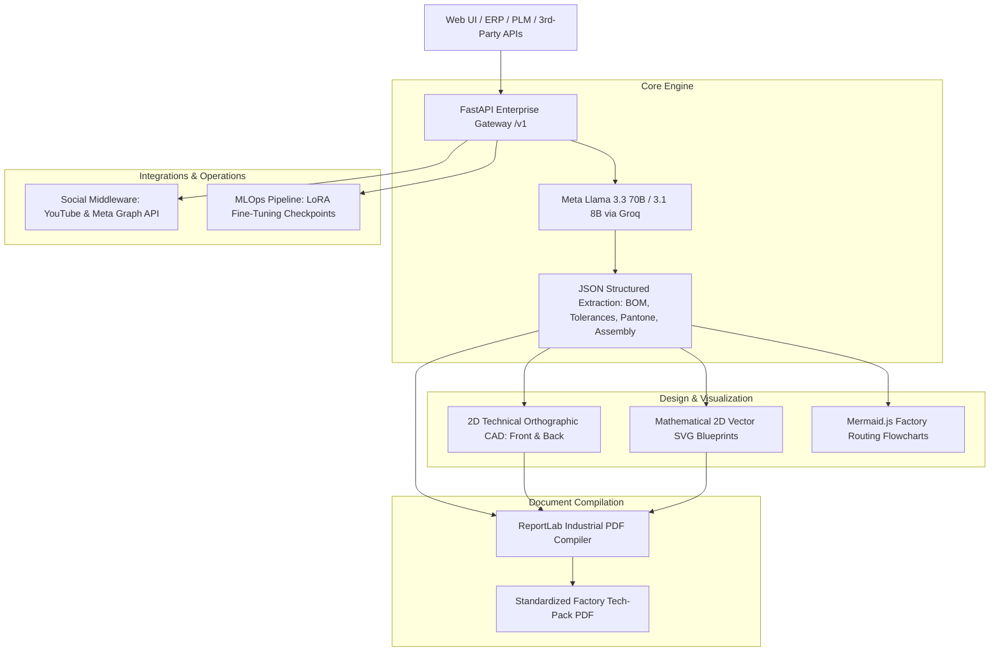

# Fashion TechPack Engine (Cloudy365 AI)

[](https://www.python.org/)
[](https://fastapi.tiangolo.com/)
[](https://ai.meta.com/llama/)
[](https://www.reportlab.com/)
[](#license)

> **Autonomous Fashion-Tech Spec Engine, 2D CAD Synthesis, MLOps Continuous Fine-Tuning & Enterprise Social Middleware.**

---

## 📌 Overview

**Cloudy365 TechPack AI** transforms natural language apparel and footwear concepts into factory-ready **Technical Specification Packs (Tech-Packs)** in seconds.

Instead of spending days manually drafting vector flats, compiling Bills of Materials (BOM), calculating tolerances, and mapping factory workflows, this platform automates the entire lifecycle:
- Extracts structured engineering specifications, BOM, metric dimensions (cm), Pantone TCX colorways, and construction seam codes.
- Generates orthographic **2D CAD flats** (Front & Back elevation views) and pure **vector SVG blueprints**.
- Builds dynamic, interactive **assembly flowcharts** using Mermaid.js.
- Compiles standardized, printable **Tech-Pack PDF documents** ready for production handoff.
- Offers an **OpenAI-compatible API Gateway (`/v1`)** for ERP/PLM integrations.
- Connects to social media via **Omnichannel Social Middleware** (YouTube & Facebook Auto-Responder).
- Includes an **MLOps Continuous Fine-Tuning Pipeline** for proprietary LoRA adapter training.

---

## 🏛 System Architecture



---

## ✨ Key Features

### 1. 🧵 Autonomous TechPack & BOM Engine
- Conversational chat interface with multi-turn prompt refinement.
- Generates exhaustive **Bills of Materials (BOM)**: fabric composition, GSM weights, treatments (e.g., DWR, antimicrobial).
- Precision metric measurements in centimeters ($\pm\text{tolerance}$).
- Pantone TCX codes and Hex color palettes.
- Detailed engineering rationale explaining seam and fabric selections.

### 2. 📐 Technical CAD & Vector SVG Synthesis
- Orthographic 2D technical drawings showing **Dual Elevation Views** (Front and Back).
- Precision vector SVG blueprints featuring dashed stitch paths, dimensional arrows, and callouts.
- Direct export compatibility for AutoCAD and Adobe Illustrator workflows.

### 3. 📄 Industrial PDF Spec Sheet Generator
- High-resolution, multi-page vector PDF generation built with ReportLab.
- Embeds technical flats, BOM breakdown tables, measurement charts, and assembly steps in a standardized factory template.

### 4. 🔌 OpenAI-Compatible API Gateway
- Full drop-in compatibility for existing OpenAI SDKs and tooling:
  - `GET /v1/models` — Lists available models (`llama-3.3-70b-versatile`, `flux-1-dev`, custom LoRAs).
  - `POST /v1/chat/completions` — Standard OpenAI schema endpoint for seamless PLM/ERP integration.
  - `GET /v1/health` — Telemetry, gateway status, and latency monitoring.

### 5. 📱 Omnichannel Social Middleware
- **YouTube API v3 Integration**: Syncs and retrieves audience comments and design feedback.
- **Facebook / Meta Graph API**: Broadcasts collection drops and automates customer support responses.

### 6. 🔬 MLOps Continuous Fine-Tuning
- Fine-tune custom LoRA adapters on proprietary brand patterns and historical tech-packs.
- Inspect adapter checkpoints, ranks, and weights directly from the platform interface.

---

## 🛠 Tech Stack

- **Backend:** Python 3.10+, FastAPI, Uvicorn, Pydantic v2
- **AI & LLM:** Meta Llama 3.3 (70B) & Llama 3.1 (8B) via Groq API
- **Document Synthesis:** ReportLab, Pillow (PIL), Vector SVG
- **Frontend:** HTML5, Modern Tailwind CSS, Lucide Icons, Mermaid.js
- **Integrations:** Meta Graph API (v19.0), YouTube Data API v3
- **Configuration:** Python-Dotenv, JSON Caching

---

## 🚀 Quick Start Guide

### 1. Prerequisites
- Python 3.10 or higher
- Git installed on your system

### 2. Clone the Repository
```bash
git clone https://github.com/Engr-IsrarUllah/fashion-techpack-engine.git
cd fashion-techpack-engine
```

### 3. Set Up Virtual Environment
```bash
# Windows
python -m venv venv
venv\Scripts\activate

# macOS / Linux
python3 -m venv venv
source venv/bin/activate
```

### 4. Install Dependencies
```bash
pip install -r requirements.txt
```

### 5. Configure Environment Variables
Copy the template file to `.env`:
```bash
# Windows PowerShell
Copy-Item .env.example .env

# Linux / macOS
cp .env.example .env
```

Open `.env` and fill in your API credentials:
```ini
GROQ_API_KEY=gsk_your_groq_api_key_here
YOUTUBE_API_KEY=AIzaSy_your_youtube_api_key_here
FB_PAGE_ACCESS_TOKEN=EAAX...your_facebook_access_token_here
FB_PAGE_ID=your_facebook_page_id_here
```

> **Note:** If you do not provide external API keys, the server will operate in high-fidelity mock/fallback mode for testing and development.

### 6. Run the Server
```bash
python main.py
```
Or with Uvicorn directly:
```bash
uvicorn main:app --host 127.0.0.1 --port 8000 --reload
```

The application is now live at:
- **Interactive Web App:** [http://127.0.0.1:8000/](http://127.0.0.1:8000/)
- **Swagger Interactive API Docs:** [http://127.0.0.1:8000/docs](http://127.0.0.1:8000/docs)
- **ReDoc API Documentation:** [http://127.0.0.1:8000/redoc](http://127.0.0.1:8000/redoc)

---

## 🧪 Verification & Testing

A verification test suite is included to ensure all gateway endpoints and generation modules are fully functional:

```bash
python verify_architecture.py
```

This verifies:
1. `GET /v1/health` (Telemetry & gateway health)
2. `GET /v1/models` (Catalog registry)
3. `POST /v1/chat/completions` (OpenAI compatibility)
4. `POST /api/techpack/generate` (Spec, CAD, Mermaid, & PDF compilation)
5. `GET /api/social/sync-youtube` & `POST /api/social/post-facebook` (Social connectors)
6. `GET /api/mlops/adapters` (MLOps fine-tuning pipeline)

---

## 📡 API Reference Overview

| Method | Endpoint | Description |
|---|---|---|
| `GET` | `/v1/health` | Gateway status, protocol, and latency telemetry |
| `GET` | `/v1/models` | List available models (OpenAI format) |
| `POST` | `/v1/chat/completions` | Standard OpenAI chat completions endpoint |
| `POST` | `/api/techpack/generate` | Generates full TechPack, CAD views, flowchart & PDF |
| `POST` | `/api/techpack/export-pdf` | Exports structured JSON spec to PDF |
| `GET` | `/api/social/sync-youtube` | Fetches recent YouTube comment threads |
| `POST` | `/api/social/post-facebook` | Publishes broadcast messages to Facebook Page |
| `POST` | `/api/social/auto-reply` | Autonomous social inquiry responder |
| `GET` | `/api/mlops/adapters` | Lists registered LoRA adapter checkpoints |
| `POST` | `/api/mlops/start-fine-tuning` | Initiates continuous fine-tuning job |
| `GET` | `/api/config/keys` | Returns current masked API credentials status |
| `POST` | `/api/config/keys` | Dynamically updates runtime API keys |

---

## 📁 Repository Structure

```
cloudy365-techpack-ai/
├── main.py                          # Main FastAPI application & core pipeline
├── verify_architecture.py           # Automated end-to-end verification test suite
├── index.html                       # Modern, responsive single-page web UI
├── requirements.txt                 # Python project dependencies
├── .env.example                     # Environment variables template
├── .gitignore                       # Git ignore rules (secrets, venv, large files)
├── CLIENT_SPECIFICATION_DOCUMENT.md # Detailed architectural & engineering whitepaper
├── static/                          # Static assets directory
│   ├── images/                      # Generated orthographic CAD images & SVGs
│   └── pdfs/                        # Compiled factory Tech-Pack PDF sheets
└── README.md                        # Project documentation
```

---

## 🔒 Security & Privacy

- All sensitive credentials are kept strictly in `.env` and are excluded from Git version control.
- Never commit `.env` or `.keys_cache.json` to public repositories.
- Files over 100MB (such as custom `.safetensors` model weights or zip archives) are pre-configured in `.gitignore`.

---

## 📄 License

This project is licensed under the [MIT License](LICENSE).
